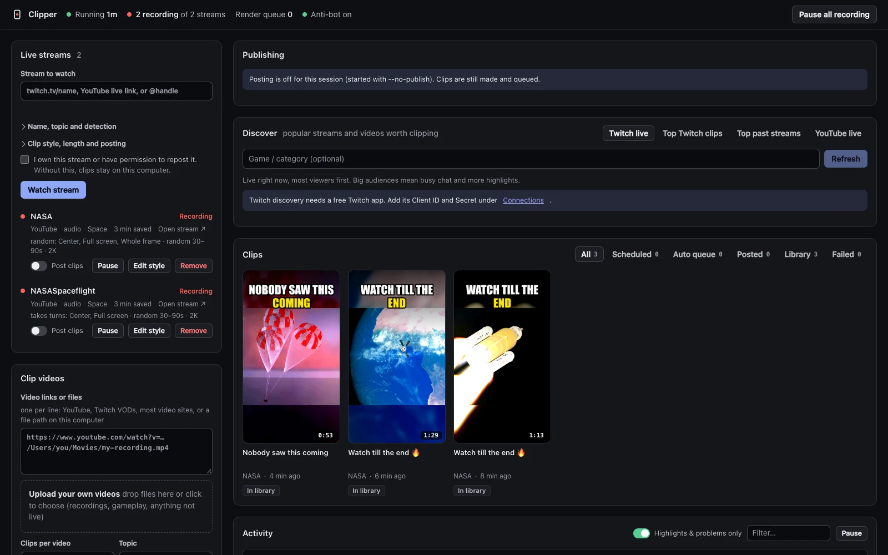

# Clipper

**Live streams and videos → vertical Shorts / Reels, automatically.**

Clipper watches Twitch and YouTube live streams (or any video link or file) and finds the
highlight moments from chat spikes and audio excitement. It cuts 30–90 s vertical clips with
captions, a hook, a thumbnail and an optional AI voiceover, and can post them to **YouTube
Shorts** and **Facebook Reels** on a safe schedule. You control it all from a local web
dashboard.

```
 live streams ──► record (highest quality) ──► chat / audio spike ──┐
                                                                    ├─► clip ─► captions + hook ─► 9:16 render ─► thumbnail ─► queue ─► post
 videos / files ─► download (or just the highlights) ─► loudest moments ┘
```

[](https://github.com/k-a-l/clipper/actions/workflows/ci.yml)
· MIT license · macOS, Windows, Linux · Python 3.12+ · **[Website](https://k-a-l.github.io/Clipper)**



## Features

- **Live recording** of Twitch and YouTube at the stream's highest quality (1080p60 / 1440p / 4K),
  lossless, with automatic reconnects.
- **Highlight detection** from chat-velocity spikes and loudness spikes.
- **Ended streams and normal videos**: paste a link (or watch a stream that has ended) and Clipper
  fetches just the audio, finds the highlights, then downloads only those minutes of video.
- **Layouts**: Center, Full screen, Whole frame, Streamer on top/below (webcam auto-detect). Pick
  one, or rotate / randomise them. If the streamer isn't on camera, the clip falls back to Full screen.
- **Random clip length** (30–90 s by default) so uploads don't all look the same.
- **Captions** (faster-whisper, karaoke style), hook line, smart thumbnail, 2K output.
- **AI story** (optional, local via Ollama): specific hook, title, description and a spoken intro
  (Kokoro / Chatterbox TTS), with a guard against made-up facts.
- **Many channels and Pages**: connect several YouTube channels and Facebook Pages and post each clip to
  one, some or all of them, each with its own daily limit, spacing, scheduling and auto-post.
- **Dashboard**: add streams, see what's recording, review / re-cut / restyle clips, post or schedule.

## See it in action

Clips made and uploaded by Clipper, posted to a YouTube channel and a Facebook Page at the same time:

- **YouTube Shorts:** <https://www.youtube.com/@HypeLoop-n1>
- **Facebook Reels:** <https://www.facebook.com/HypeLoop.n1/reels/>

## Install

You need about 2 GB free (plus room for recordings). The installers set up **FFmpeg**,
**Node.js** (YouTube needs it) and **uv**, which brings its own Python 3.12, then the `clipper`
command.

**macOS / Linux**

```bash
curl -fsSL https://raw.githubusercontent.com/k-a-l/clipper/main/scripts/install.sh | sh
```

**Windows 10/11** (PowerShell)

```powershell
powershell -ExecutionPolicy ByPass -c "irm https://raw.githubusercontent.com/k-a-l/clipper/main/scripts/install.ps1 | iex"
```

**Docker** (servers, NAS)

```bash
docker run -d --name clipper --restart unless-stopped \
  -v clipper-data:/data -p 127.0.0.1:8787:8787 ghcr.io/k-a-l/clipper:latest
# put your .env in the volume: docker cp .env clipper:/data/.env && docker restart clipper
```

<details>
<summary><b>Manual install</b> (if you prefer to do each step yourself)</summary>

1. Install **FFmpeg** and **Node.js**:
   - macOS: `brew install ffmpeg node`
   - Ubuntu/Debian: `sudo apt install ffmpeg nodejs`
   - Fedora: enable RPM Fusion, then `sudo dnf install ffmpeg nodejs`
   - Arch: `sudo pacman -S ffmpeg nodejs`
   - Windows: `winget install Gyan.FFmpeg OpenJS.NodeJS.LTS`
2. Install Clipper with Python 3.12+ (any one of these):
   ```bash
   uv tool install --python 3.12 git+https://github.com/k-a-l/clipper
   pipx install git+https://github.com/k-a-l/clipper
   pip install git+https://github.com/k-a-l/clipper        # inside a virtualenv
   ```
3. Create your settings: `mkdir ~/Clipper && cp .env.example ~/Clipper/.env`, then run
   `clipper gen-key` and paste the key into `TOKEN_ENCRYPTION_KEY=`.
</details>

<details>
<summary><b>From source</b> (to develop)</summary>

```bash
git clone https://github.com/k-a-l/clipper && cd clipper
uv venv --python 3.12 && uv pip install -e ".[dev]"
uv run pytest
uv run clipper ui --open
```
</details>

## Quick start

```bash
clipper ui --open          # dashboard at http://127.0.0.1:8787
```

1. **Live streams**: paste `twitch.tv/name` or a YouTube live link → *Watch stream*.
2. **Clip videos**: paste video links or drop your own files.
3. Clips appear under **Clips**. Click one to play, re-cut, restyle, post or schedule it.
4. To post: **Connections** → add YouTube / Facebook (see **[docs/CREDENTIALS.md](docs/CREDENTIALS.md)**),
   and mark a source *"I own this / have permission"*.

Other commands:

| Command | What it does |
|---|---|
| `clipper ui --open` | everything plus the dashboard (recommended) |
| `clipper ui --no-publish` | same, but nothing gets posted this session |
| `clipper run` | headless: watch, record, clip, post |
| `clipper vod URL… --clips 3` | clip finished videos or local files |
| `clipper status` | what's recording, queued, posted |
| `clipper stats` | views, likes and comments of posted clips |
| `clipper auth-youtube` | connect a YouTube channel |
| `clipper auth-facebook --user-token …` | connect a Facebook Page |
| `clipper gen-key` | new encryption key for saved logins |

## Where things are

| | macOS / Linux | Windows |
|---|---|---|
| Settings | `~/Clipper/.env` | `%USERPROFILE%\Clipper\.env` |
| Data (recordings, state, tokens) | `~/Clipper/storage/` | `%USERPROFILE%\Clipper\storage\` |
| Clips (changeable in the dashboard) | `~/Clipper/storage/library/Clips/` | same, under `%USERPROFILE%` |
| Log | `~/Clipper/storage/logs/clipper.log` | same |

Set the `CLIPPER_HOME` environment variable to use another folder. A `.env` in the folder you
start `clipper` from is read too, and wins.

## Configuration

Every setting is optional and can go in `.env` (see [`.env.example`](.env.example)). Common ones:

| Setting | Default | |
|---|---|---|
| `YOUTUBE_PRIVACY_STATUS` | `private` | `public` once you're happy |
| `FACEBOOK_VIDEO_STATE` | `DRAFT` | `PUBLISHED` to post directly |
| `MAX_POSTS_PER_DAY` / `MIN_POST_SPACING_MINUTES` | 3 / 180 | posting pace per platform |
| `VOD_MAX_HEIGHT` | 4320 | highest source resolution to download |
| `RANDOM_CLIP_MIN_S` / `RANDOM_CLIP_MAX_S` | 30 / 90 | random clip length range |
| `RAW_RETENTION_HOURS` | 6 | how long raw live recordings are kept |
| `VIDEO_ENCODER` | `auto` | NVENC / QSV / VideoToolbox when available, else libx264 |

Optional local AI (hooks, titles, voiceover): **[docs/OPTIONAL_AI.md](docs/OPTIONAL_AI.md)**.

## Responsible use

Clipper only posts clips from sources you've marked as **yours or permitted**. Everything else
stays on your computer. Reposting other creators' content without permission breaks YouTube's and
Meta's policies and copyright law. Many streamers run official clipping programs.

## Contributing

Issues and pull requests are welcome: see [CONTRIBUTING.md](CONTRIBUTING.md). Report security
problems privately: see [SECURITY.md](SECURITY.md).

## License

[MIT](LICENSE). Third-party components and their licenses: [THIRD_PARTY_COMPONENTS.md](THIRD_PARTY_COMPONENTS.md).
FFmpeg, espeak-ng (via Kokoro) and the bgutil PO-token helper run as **separate programs** and
keep their own licenses.
